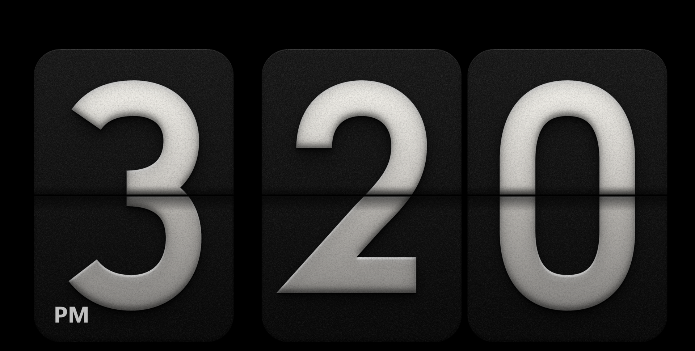
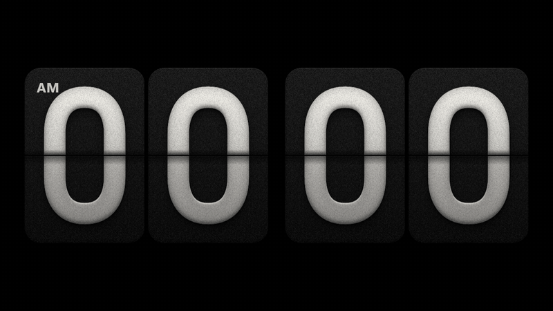
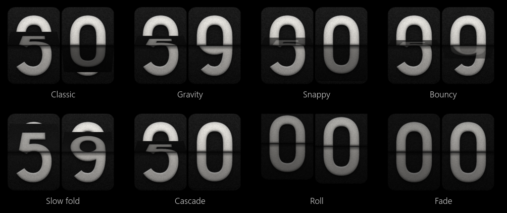
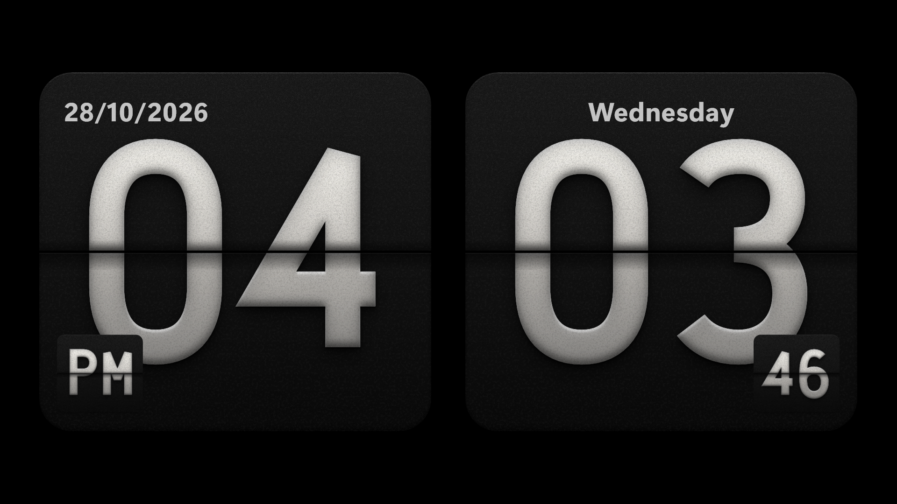
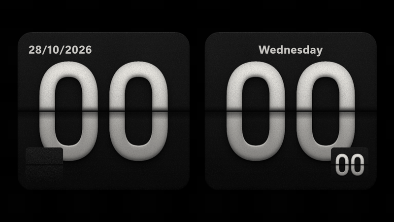
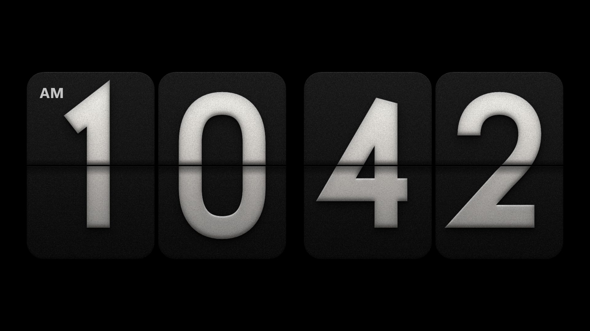
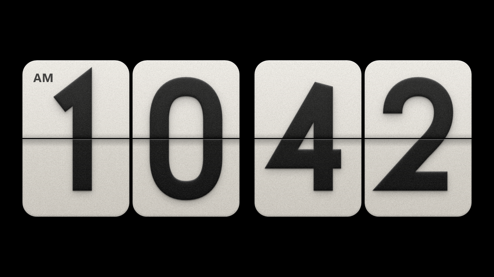
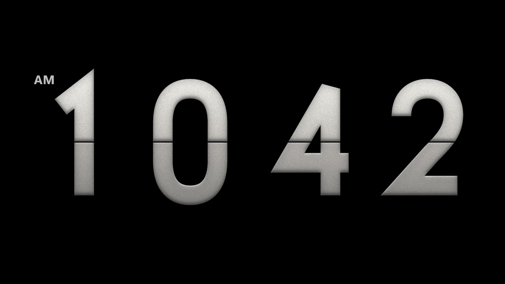
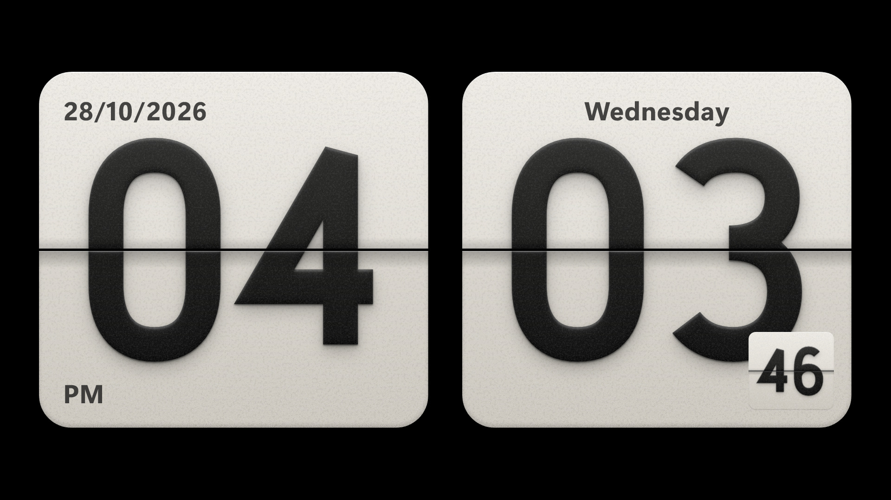
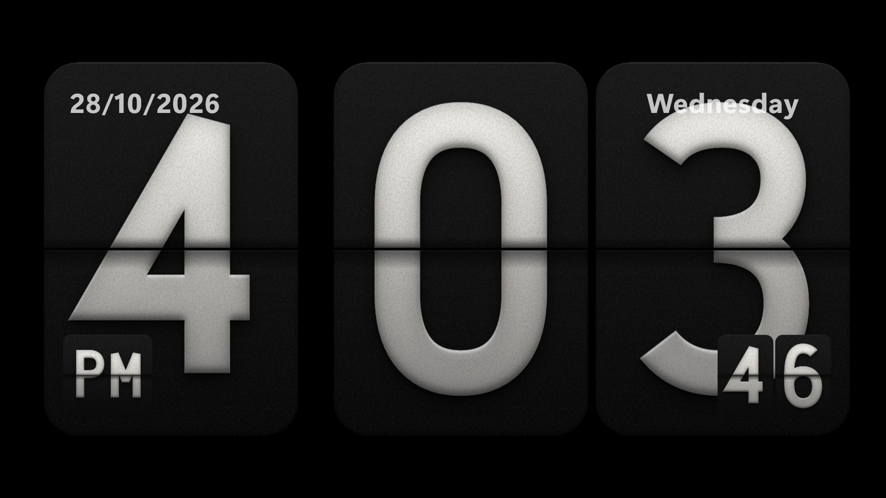

# Lock Screen Flip Clock

A mechanical flip clock for the Windows 11 lock screen. One card per digit,
raised puff-print numerals on paper-grain cards, flaps that tip over in
perspective and land with a clack, an airport-board roll-in when the lock screen
comes up, and a vibration thump you hear rather than feel. A
[Windhawk](https://windhawk.net) mod.



<sub>Captured on the lock screen itself (Windows 11 26H2, build 26300, 4K), from
inside LockApp - nothing outside can screenshot the secure desktop.</sub>



**With sound:** [dark cards, Airport board clack + light thump](../../docs/media/lock-screen-flip-clock/demo.mp4) ·
[light cards, Gravity flaps, Mechanical + firm thump](../../docs/media/lock-screen-flip-clock/demo-light.mp4) ·
[Pairs with seconds and AM / PM cards](../../docs/media/lock-screen-flip-clock/demo-pairs.mp4)

## What it does

- **Real flaps.** Each card is four layers - static top, static bottom, top flap,
  bottom flap - each the whole card clipped to one half, so they line up to the
  pixel. The top flap falls toward you and vanishes edge-on; the bottom flap
  appears past 70° in shadow, swings down and lands. Black cards sink into
  near-black as they turn from the light, paper cards dim in a warm tone.
- **Eight flip styles.** Classic, Gravity (a simulated fall, fastest at the
  bottom, bouncing twice off the stack), Snappy, Bouncy, Slow fold (with a
  sheen), Cascade (digit by digit, like a departure board), Roll and Fade.

  

- **Two card styles.** A card per digit, or Pairs: one card for the hours and one
  for the minutes, with the same Figma numerals two to a card.

  

- **On the cards** - each its own toggle: the date in the hours card's top left,
  the weekday on top of the minutes card, the seconds as small flip cards in the
  minutes card's bottom right, and AM / PM in the hours card's corner or as its
  own small flip card. The small cards flip on their own while the big ones stay.

  

- **Airport-board roll-in.** When the lock screen appears - Win+L, waking the
  display, coming back from the sign-in prompt - every card starts at 0 and
  rattles forward flap by flap to the time, each at its own pace.
- **Sound, synthesised from scratch.** No audio files. Every flap is rendered as
  it lands: a sharp high-passed noise tick, a short hollow band-passed body and a
  dull pitch-dropping knock, all through one compressor so a whole board landing
  at once rattles instead of clipping. Five voices: Airport board, Mechanical (the
  rush of the falling flap, then the clack), Click, Whoosh, Soft tap.
- **Vibration thump.** LyricDock buzzes the phone's motor for 30 or 50 ms as
  the flaps land. A PC has no motor, so this one is sound: a sine that starts
  near 115 Hz and sinks towards 55 Hz like a motor spinning down, a faint 165 Hz
  buzz riding on it, a 2.5 ms attack and a 12 ms tail, softly saturated so its
  harmonics still carry on laptop speakers that cannot play 60 Hz.
- **Only the clock.** The Windows clock and the widgets are hidden; the media
  controls and the network and battery icons stay on top. Black (paper with
  light cards and no cards), dimmed wallpaper, or wallpaper behind.
- Dark, light or automatic cards (light by day, dark at night), optional
  seconds, 12/24-hour or following Windows with an AM/PM mark, cards on or
  numerals only, size, gaps, dim, an optional date line.
- **Quiet when nobody is looking.** Windows suspends the lock screen app once
  the display turns off, so a locked PC never clicks through the night; the mod
  also mutes itself on the display-off notification in case that ever changes.

| | | |
| --- | --- | --- |
|  |  |  |
| Dark | Light | Numerals only |
|  |  | |
| Light Pairs | Digits with the extras | |

<sub>These three, the styles strip and the GIF are rendered by the preview
harness in `tests/` from the mod's own code, frame-exact.</sub>

### Listen

The sounds exactly as the mod renders them, at the default volume:
[airport board](../../docs/media/lock-screen-flip-clock/sounds/sound-solari.wav) ·
[mechanical](../../docs/media/lock-screen-flip-clock/sounds/sound-mechanical.wav) ·
[click](../../docs/media/lock-screen-flip-clock/sounds/sound-click.wav) ·
[whoosh](../../docs/media/lock-screen-flip-clock/sounds/sound-whoosh.wav) ·
[soft tap](../../docs/media/lock-screen-flip-clock/sounds/sound-soft.wav) ·
[light thump](../../docs/media/lock-screen-flip-clock/sounds/thump-light.wav) ·
[firm thump](../../docs/media/lock-screen-flip-clock/sounds/thump-firm.wav) ·
[a whole board landing](../../docs/media/lock-screen-flip-clock/sounds/board-solari.wav)

## Install

It is not in the Windhawk catalogue yet. Until it is:

1. In Windhawk, click **Create a New Mod**.
2. Replace the template with [`lock-screen-flip-clock.wh.cpp`](lock-screen-flip-clock.wh.cpp), **Compile Mod**, then **Exit Editing Mode**.
3. Press <kbd>Win</kbd>+<kbd>L</kbd>.

Or from an elevated terminal:

```powershell
& "C:\Program Files\Windhawk\windhawk-cli.exe" mod install --file lock-screen-flip-clock.wh.cpp
```

## Settings

| Setting | Default | What it does |
| --- | --- | --- |
| Card style | A card per digit | A card per digit, or one for the hours and one for the minutes (the same numerals, two to a card). |
| Card colour | Dark | Dark cards with light numerals, light cards with dark numerals, or Automatic: light by day, dark between the two hours below. |
| Automatic - dark from / light from | 22 / 7 | The hours the Automatic colour switches at. At the switch every card flips over to the new colour. |
| Time format | Follow Windows | 12-hour puts AM or PM in the corner of the hours card; single-digit hours collapse to one card. |
| Seconds | Off | Small flip cards in the minutes card's bottom right, or full-size cards. |
| AM / PM | In the corner | In the hours card's corner, or a small flip card in its bottom left. 12-hour time only. |
| Date on the hours card | Off | The short date, top left, in your locale's format. |
| Day of the week on the minutes card | Off | On top of the (last) minutes card. |
| Flip animation | Classic | Classic, Gravity, Snappy, Bouncy, Slow fold, Cascade, Roll, Fade. |
| When the lock screen appears | Airport board | Every card rolls from 0 to the time; or flip from blank cards; or nothing. |
| Animation speed | 100 % | 30-300 %. |
| Flip sound | Mechanical | Off, Airport board, Mechanical, Click, Whoosh, Soft tap. |
| Sound volume | 40 % | Relative to the system volume. |
| Sound latency | 0 ms | Bluetooth speakers and audio processors play sound late (this test machine: 140-280 ms). Raise it until the clack lands with the flap: the flaps wait for the sound. |
| Sound with seconds on | Only the minute | A tick every second gets tiring; or every flip. |
| Vibration thump | Light | The haptic tick as sound: Off, Light (30 ms), Firm (50 ms). |
| Show the cards | On | Off: numerals only - the flip still moves them. |
| Background | Black | Black (paper with light cards and no cards), dimmed wallpaper, or wallpaper. |
| Arrangement | Follow the screen | Side by side when wide, stacked when tall; or force either. |
| Size | 96 % | How much of the screen the cards fill. |
| Gap between digits / groups | 3 % / 14 % | Of a card's width. |
| Dim | 0 % | Darkens the clock, for a bedroom. |
| Show the date | Off | "Wednesday, 28 October" below the cards, in your locale's order. |
| Hide the Windows clock / the widgets | On / On | Put back exactly as they were when the mod is turned off. |

## How it works

LockApp is a UWP XAML app whose process is suspended while the PC is unlocked
and thaws when the lock screen comes up. A worker thread finds its CoreWindow and
installs a `WH_GETMESSAGE` hook on that UI thread, so every XAML read and write
happens there; settings changes and teardown run synchronously on it through a
`WH_CALLWNDPROC` hook - the approach of ali0zdas's
[Lock Screen Clock Styler](https://windhawk.net/mods/lock-screen-clock-styler),
with no XAML Diagnostics TAP, so it coexists with other XAML mods.

- **Where it lives.** The lock screen is a curtain - `LockScreenContent`, inside
  a scroll viewer two screens tall - that slides away when you dismiss it. The
  clock goes inside it, just under `LockScreenTextContent`, so it leaves with
  the curtain and the media controls and status icons stay on top. Hosted any
  higher it would stay behind.
- **The cards** are drawn once per size and colour with Direct2D: the Figma "Puff
  3D" effect stack from LyricDock - drop shadows, inner shadows, fractal-noise
  grain - ported from its SVG filters primitive by primitive (Shadow,
  ColorMatrix, LinearTransfer, Turbulence, Composite), then handed to XAML as
  `WriteableBitmap`s at the screen's real pixel size.
- **No XAML event handler is ever registered** - a delegate outliving the DLL
  would call into unloaded code. Each flip, image swaps included, is one
  self-contained `Storyboard` built from precomputed keyframes, sampled from the
  same CSS curves the original used (`cubic-bezier` timing, WAAPI keyframe
  interpolation), with real 3D perspective (`PerspectiveTransform3D` on the card,
  `CompositeTransform3D` on the flaps).
- **Sound** for a whole flip - every card's clacks at their own times, the
  thump, through one compressor modelled on Web Audio's DynamicsCompressor with
  its look-ahead - is rendered into one buffer and played through XAudio2.

Only `LockApp.exe` is touched - never `LogonUI.exe` or the secure desktop where
you type your password.

## How it was tested

Everything here ran on the machine it was built on, not only in theory.

- **Self-checks** (`tests/run-preview.ps1 check`): 44 assertions over the mod's
  real code - easing curves, flap keyframes for every style, 12/24-hour and
  collapsed tens, automatic colour hours, what each card prints in its corners,
  the Pairs roll-in (00 reaches 46 in six flaps), and every sound: never clips, loudest
  at the landing, the thump is a low, short knock (66-70 Hz, 98 % of its energy
  inside the motor run + 20 ms), clacks 4 ms apart are thinned, cards landing
  together share one thump.
- **Card art** compared side by side with LyricDock's baked Figma images.
- **Frame-exact film** (`tests/run-preview.ps1 frames`): the real clock in a
  XAML island, storyboards paused and seeked frame by frame - the source of the
  GIFs - plus a 60 fps screen recording of it running live, checked for any frame
  where an image swap and a flap disagree.
- **The sound really reaches the speakers**: `tests/loopback.cpp` records the
  speakers (WASAPI loopback) while the clock plays, and `tests/find-sound.py`
  finds each played sound inside the recording by normalised cross-correlation
  against a time-reversed null - with Spotify playing over it. On the desktop
  and on the lock screen alike: 22 of 27 lock-screen sound events found, most at
  0.8-0.99.
- **On the real lock screen** (`tests/lockapp-test.cpp`): the mod compiled into a
  test DLL and loaded into the running LockApp, talking through LockApp's own
  sandbox folder, screenshotting itself with `RenderTargetBitmap` from inside.
  Verified there: finding the curtain, the card art at 4K, the roll-in, minute
  flips with sound, display off (LockApp suspended) and on again (roll-in
  replays), handing over to the sign-in prompt and coming back, a settings change
  rebuilding the clock, the 12-hour card count changing at 9:59 -> 10:00 and
  12:59 -> 1:00 (run ahead in time), teardown putting the Windows clock back, and
  a clean unload.

Built and tested on Windows 11 26H2 (build 26300) with Windhawk 2.0 alpha, x64.

## Running the tests

```powershell
.\tests\run-preview.ps1 check  $env:TEMP\lsfc-check     # 38 self-checks + WAVs of every sound
.\tests\run-preview.ps1 art    $env:TEMP\lsfc-art       # every card, both colours, as PNG
.\tests\run-preview.ps1 frames $env:TEMP\lsfc-frames start=10:59:57 secs=5   # needs an unlocked desktop
.\tests\run-lockapp-test.ps1                            # test build for the real lock screen
```

`lockapp-test.cpp` explains the lock screen rig: no Windhawk install and no UAC,
it is loaded straight into LockApp and talks through LockApp's own sandbox
folder. Changes are in [`CHANGELOG-lock-screen-flip-clock.md`](../../docs/per-mod/CHANGELOG-lock-screen-flip-clock.md).

## Credits

- The design and the motion are ported from the flip clock in
  [LyricDock](https://github.com/DhakadG/lyricdock), designed in Figma.
- The lock screen plumbing follows
  [Lock Screen Clock Styler](https://github.com/ali0zdas/windhawk-mod-lock-screen-clock-styler)
  by ali0zdas (MIT).

## License

[MIT](../../LICENSE) © 2026 lost_husky
